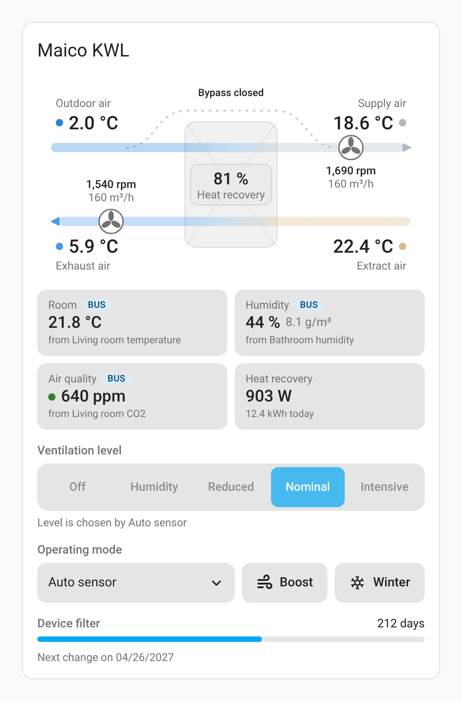
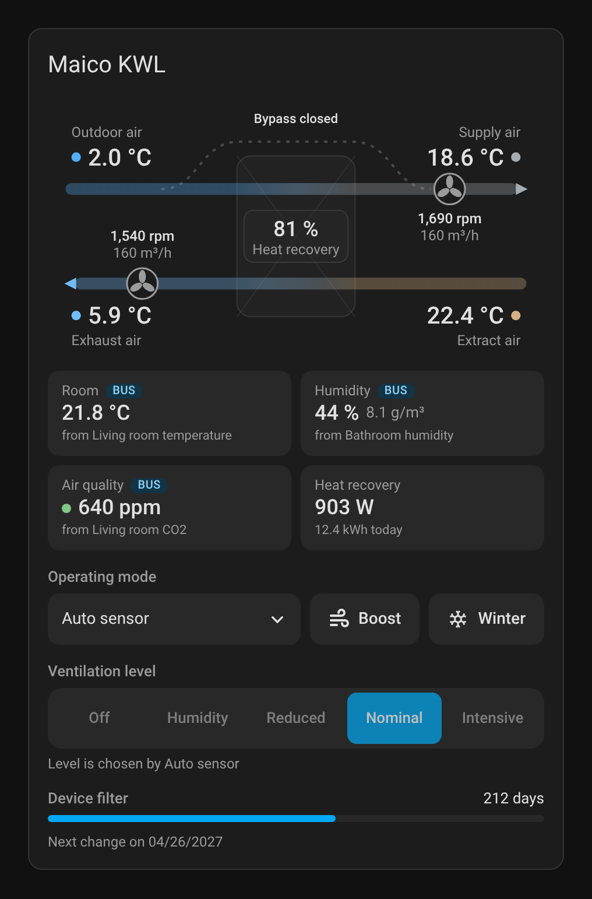

# Dashboard card

[README](../README.md) | [Documentation overview](../README.md#documentation)

The integration brings its own dashboard card. It is loaded automatically once the integration is
set up, so there is nothing to download and no dashboard resource to add.

<table>
  <tr>
    <td></td>
    <td></td>
  </tr>
</table>

*The screenshots are rendered by the card's automated test with example values.*

## Adding the card

Edit a dashboard, choose **Add card** and search for **Maico KWL**. The card picks the unit on its
own; with more than one unit, choose it in the card editor. In YAML:

```yaml
type: custom:maico-kwl-card
device_id: 0123456789abcdef0123456789abcdef  # optional, the first unit if left out
```

After an update of the integration, reload the dashboard in the browser once, so the browser loads
the new card.

## What it shows

- **Airflow diagram**: outdoor air to supply air on top, extract air to exhaust air below, the heat
  exchanger with the heat recovery efficiency in between. The colour of the air follows its
  temperature (blue when cold, grey around room temperature, orange to red when hot), so the heat
  exchange is visible at a glance. With the summer bypass open, the outdoor air takes the arc over
  the exchanger. Fans show their speed and airflow, a PTC heater lights up while it heats. A soft
  sheen moves along the ducts while the fans run; nothing moves with *reduce motion* turned on.
- **Room values**: room temperature, humidity, air quality and heat recovery power. Values that the
  integration feeds to the unit over the bus carry a **BUS** badge and name their source entity;
  the badge turns orange when no value has been written for 10 minutes (see
  [Bus inputs](bus-inputs.md)). The room temperature shows the bus value only while *Room
  temperature source* is "Bus". Air quality shows the highest CO2 sensor, without one the highest
  VOC sensor, without one the bus value. It gets a coloured dot (up to 800 ppm good, up to
  1400 ppm moderate, above poor); the same limits apply to a VOC value.
- **Controls**: operating mode, boost, season and, below them, the ventilation level. The level bar
  shows the level that runs; where the unit picks it itself (*Auto time*, *Auto sensor*) or runs
  another one (off, boost) it is locked. The off level is locked while *Disable off level* is on.
  A change of mode, boost or level shows at once and pulses until the unit reports it, which can
  take a few seconds; after 35 seconds, or when sending fails, the card shows the reported value
  again. A tap on the season opens its entity to switch between summer and winter.
- **Filters**: remaining days of every fitted filter and the date of the next change.
- **Notices and faults**: a chip in the header while the unit reports any, with the messages by
  name when tapped. The bypass notice is left out, the diagram already shows it.

Parts the unit does not have (accessories, sensors) are simply left out. Without a summer bypass
entity, or while its state is unknown, the diagram draws no bypass. Tapping a value opens its
entity, for bus values the source entity. On narrow screens the level bar switches to icons.

## Problems with the card

See [Troubleshooting](troubleshooting.md#the-dashboard-card-is-missing-or-shows-custom-element-doesnt-exist)
if the card is missing or shows "Custom element doesn't exist".
